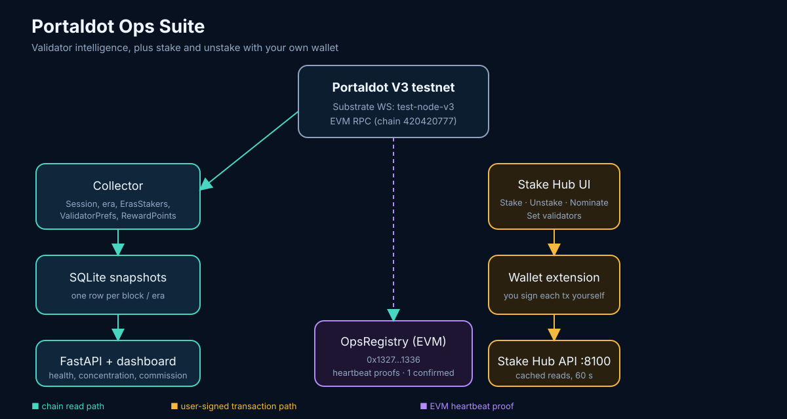

# Portaldot Ops Suite

Read-only operational intelligence for **Portaldot V3 testnet** staking: validator health, stake concentration, commission risk, and verifiable on-chain snapshots.

> Portaldot Hacker House 2026 · Check-in build

## Network

| Item | Value |
|---|---|
| Substrate WS | `wss://test-node-v3.portaldot.dev` |
| EVM RPC | `https://test-evm-rpc-v3.portaldot.dev` |
| EVM chain ID | `420420777` |
| Explorer | `https://node-console.portaldot.dev` |
| Token | tPOT (14 decimals) |

Testnet only. No mainnet data is mixed into this dashboard.

## What works now

| Feature | Status |
|---|---|
| Collector: block, session validators, era, staking (`ErasStakers`, `ErasValidatorPrefs`, `ErasRewardPoints`) | Working, one-shot run (`--once`) |
| SQLite snapshot store | Working |
| Read-only API (`/api/v1/...`) | Working, see list below |
| Validator health dashboard (`/`) | Working, served by FastAPI |
| Backend unit tests | 17 passed |
| OpsRegistry heartbeat contract | **Deployed and heartbeat confirmed** on Portaldot V3 EVM (chain 420420777): `0x132748201FbCB051CA6D73d26f27540a214d1336`, deploy tx `0xd1a94694ac01b494be79e977361d956af93a52e420fc9169c4c6219aadfb9a20`, heartbeat tx `0x1166cfc1ba80a9663465c8106224d3b3672fadf241b525620c13698d73eafe77` |

## Related work: Stake Hub

Staking actions on the same testnet were verified on-chain with a separate project, `portaldot-stake-hub`:

- Stake 1 tPOT, unstake 1 tPOT, nominate 2 validators.
- Tx hashes and blocks: [`data/testnet-evidence.md`](data/testnet-evidence.md).

## Architecture



```text
Portaldot V3 WS ──> collector ──> SQLite ──> API / dashboard / alerts
Portaldot V3 EVM ──> OpsRegistry heartbeat ──> RPC receipt proof (deployed, heartbeat confirmed)
```

Layers:

- **Collector** (`backend/collector.py`, `collector_logic.py`): reads `Session.Validators`, `Staking.CurrentEra`, `Staking.ErasStakers`, `Staking.ErasValidatorPrefs`, `Staking.ErasRewardPoints`.
- **Storage** (`backend/schema.sql`): SQLite, local-first.
- **API** (`backend/api.py`): FastAPI, read-only.
- **Dashboard** (`dashboard.html`): vanilla HTML/CSS/JS, served by the API at `/`.
- **Heartbeat** (`contracts/OpsRegistry.sol`, `scripts/prepare_heartbeat.py`): contract deployed to Portaldot V3 EVM at `0x132748201FbCB051CA6D73d26f27540a214d1336` (deploy tx `0xd1a94694ac01b494be79e977361d956af93a52e420fc9169c4c6219aadfb9a20`, block 159167, status 1). Heartbeat confirmed: tx `0x1166cfc1ba80a9663465c8106224d3b3672fadf241b525620c13698d73eafe77` (block 159265, status 1, `heartbeatCount` = 1). Evidence: `data/deployment-evidence.json`.

## Run locally

```bash
python3 -m venv .venv
. .venv/bin/activate
pip install -r backend/requirements.txt
cp .env.example .env
python -m backend.collector --once      # one snapshot from V3 testnet
uvicorn backend.api:app --reload        # dashboard at http://127.0.0.1:8000
```

Run tests:

```bash
.venv/bin/python -m pytest -q
```

## API

- `GET /api/v1/health`
- `GET /api/v1/overview`
- `GET /api/v1/validators`
- `GET /api/v1/validators/{address}`
- `GET /api/v1/eras/latest`
- `GET /api/v1/blocks`
- `GET /api/v1/balance/{ss58_address}` (read-only native POT balance)
- `GET /api/v1/deployment-evidence`

## Honest limits

- Recent eras show **zero exposure** for the validators in the testnet snapshot. The dashboard shows that as-is.
- Risk score is rule-based. It has no long history yet.
- OpsRegistry is deployed (`0x132748201FbCB051CA6D73d26f27540a214d1336`) and one heartbeat is confirmed (`0x1166cfc1ba80a9663465c8106224d3b3672fadf241b525620c13698d73eafe77`, block 159265). Only one heartbeat has been sent so far; the payload snapshot is from block 159240 and is not refreshed continuously.
- The payload in `data/heartbeat-payload.json` is from an older snapshot (block 71886, era 20). It must be regenerated before deployment.

## License

MIT — see [LICENSE](LICENSE). Third-party dependencies are listed in `backend/requirements.txt`.
